## Draft Swemper tooltips
[Search controls]{.c6}

[Sökning]{.c12 .c18}

[TITLE_STRINGS]{.c12}[: ]{.c17 .c12}[Nyckelordssökning, Keyword
search]{.c12}

[{style="width: 235.01px; height: 71.52px; margin-left: 0.00px; margin-top: 0.00px; transform: rotate(0.00rad) translateZ(0px); -webkit-transform: rotate(0.00rad) translateZ(0px);"}]{style="overflow: hidden; display: inline-block; margin: 0.00px -0.00px; border: 1.33px solid #000000; transform: rotate(0.00rad) translateZ(0px); -webkit-transform: rotate(0.00rad) translateZ(0px); width: 235.01px; height: 71.52px;"}

[TOOLTIP_SV: ]{.c0}

[Systemet tillämpar ]{.c12}[oskarp sökning]{.c17 .c12}[ (s. k. fuzzy
search) vilket innebär att sökningen även ger resultat med liknande
stavningar. Sätt ord eller fraser mellan citattecken (" ") för
]{.c12}[exakt sökning]{.c17 .c12}[. Det är även möjligt att tillämpa
]{.c12}[sökoperatorer]{.c17
.c12}^[\[a\]](#cmnt1){#cmnt_ref1}[\[b\]](#cmnt2){#cmnt_ref2}^[ AND (alla
sökord ska finnas) och OR (ett eller flera sökord ska finnas).]{.c0}

[Det är för närvarande inte möjligt att använda NOT, asterisk (\*) eller
frågetecken (?) i sökningen. ]{.c0}

[Filters]{.c6}

[TITLE_STRING: ]{.c12}[Tidsperiod, Year range]{.c8}

[]{.c8}

[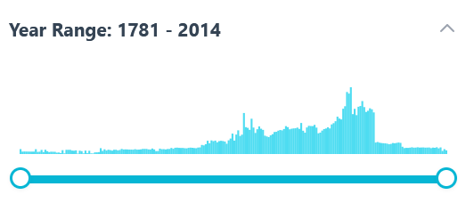{style="width: 214.50px; height: 95.55px; margin-left: 0.00px; margin-top: 0.00px; transform: rotate(0.00rad) translateZ(0px); -webkit-transform: rotate(0.00rad) translateZ(0px);"}]{style="overflow: hidden; display: inline-block; margin: 0.00px -0.00px; border: 1.33px solid #000000; transform: rotate(0.00rad) translateZ(0px); -webkit-transform: rotate(0.00rad) translateZ(0px); width: 214.50px; height: 95.55px;"}

[]{.c0}

[TOOLTIP_SV: Avgränsa sökningen till ett specifikt år eller en
period]{.c0}

[]{.c0}

[]{.c0}

[TITLE_STRINGS: Innehållstyp, Content type]{.c12}

[]{.c6}

[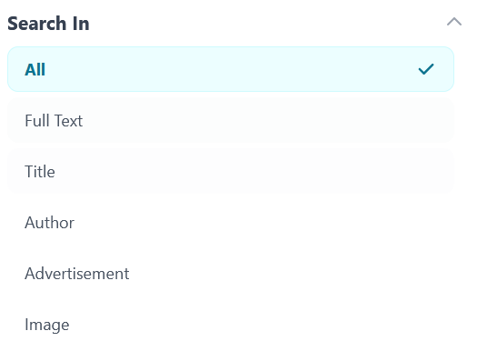{style="width: 171.50px; height: 130.12px; margin-left: 0.00px; margin-top: 0.00px; transform: rotate(0.00rad) translateZ(0px); -webkit-transform: rotate(0.00rad) translateZ(0px);"}]{style="overflow: hidden; display: inline-block; margin: -0.00px -0.00px; border: 1.33px solid #000000; transform: rotate(0.00rad) translateZ(0px); -webkit-transform: rotate(0.00rad) translateZ(0px); width: 171.50px; height: 130.12px;"}

[]{.c0}

[HINT_SV: Sök i fritext eller begränsa sökresultaten till en eller flera
specifika typer av innehåll som har identifierats automatiskt med hjälp
av maskininlärning under digitaliseringen. Observera att innehåll i
vissa fall kan ha klassificerats felaktigt eller inte identifierats
alls.]{.c0}

[]{.c31}

[TITLE_STRINGS: Publikationstitel, Publication]{.c0}

[]{.c0}

[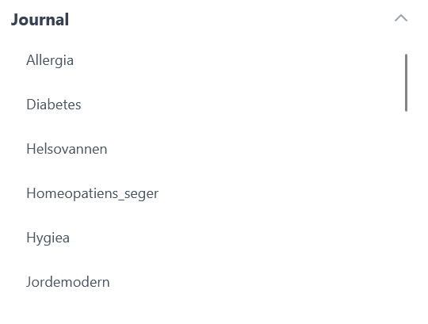{style="width: 185.50px; height: 140.72px; margin-left: 0.00px; margin-top: 0.00px; transform: rotate(0.00rad) translateZ(0px); -webkit-transform: rotate(0.00rad) translateZ(0px);"}]{style="overflow: hidden; display: inline-block; margin: -0.00px -0.00px; border: 1.33px solid #000000; transform: rotate(0.00rad) translateZ(0px); -webkit-transform: rotate(0.00rad) translateZ(0px); width: 185.50px; height: 140.72px;"}

[]{.c0}

[HINT_SV: Avgränsa sökningen till en eller flera tidskrifter]{.c0}

[]{.c0}

[TITLE_STRINGS: ]{.c12}[Bild- och
annonsfilter]{.c12}^[\[c\]](#cmnt3){#cmnt_ref3}[\[d\]](#cmnt4){#cmnt_ref4}^

[]{.c6}

[{style="width: 243.32px; height: 65.31px; margin-left: 0.00px; margin-top: 0.00px; transform: rotate(0.00rad) translateZ(0px); -webkit-transform: rotate(0.00rad) translateZ(0px);"}]{style="overflow: hidden; display: inline-block; margin: 0.00px -0.00px; border: 1.33px solid #000000; transform: rotate(0.00rad) translateZ(0px); -webkit-transform: rotate(0.00rad) translateZ(0px); width: 243.32px; height: 65.31px;"}

[]{.c0}

[TOOLTIP_SV: Begränsa sökresultaten till sidor där minst en bild
och/eller annons har identifierats automatiskt med hjälp av
maskininlärning under digitaliseringen. Vissa bilder och annonser kan ha
missats eller identifierats felaktigt.]{.c0}

[]{.c0}

[Sortera resultat]{.c6}

[]{.c6}

[{style="width: 260.54px; height: 109.76px; margin-left: 0.00px; margin-top: 0.00px; transform: rotate(0.00rad) translateZ(0px); -webkit-transform: rotate(0.00rad) translateZ(0px);"}]{style="overflow: hidden; display: inline-block; margin: 0.00px 0.00px; border: 1.33px solid #000000; transform: rotate(0.00rad) translateZ(0px); -webkit-transform: rotate(0.00rad) translateZ(0px); width: 260.54px; height: 109.76px;"}

[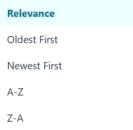{style="width: 274.00px; height: 268.00px; margin-left: 0.00px; margin-top: 0.00px; transform: rotate(0.00rad) translateZ(0px); -webkit-transform: rotate(0.00rad) translateZ(0px);"}]{style="overflow: hidden; display: inline-block; margin: 0.00px 0.00px; border: 1.33px solid #000000; transform: rotate(0.00rad) translateZ(0px); -webkit-transform: rotate(0.00rad) translateZ(0px); width: 274.00px; height: 268.00px;"}

[]{.c0}

[Sortera resultat på ]{.c0}

- [Relevans, Relevance]{.c0}
- [År (äldst först), Year (ascending)]{.c0}
- [År (nyast först), Year (descending)]{.c0}
- [Titel (A-Ö), Title]{.c0}
- [Titel (Ö-A)]{.c0}

[]{.c6}

[Sök]{.c8}

[]{.c6}

[{style="width: 532.00px; height: 82.00px; margin-left: 0.00px; margin-top: 0.00px; transform: rotate(0.00rad) translateZ(0px); -webkit-transform: rotate(0.00rad) translateZ(0px);"}]{style="overflow: hidden; display: inline-block; margin: 0.00px -0.00px; border: 1.33px solid #000000; transform: rotate(0.00rad) translateZ(0px); -webkit-transform: rotate(0.00rad) translateZ(0px); width: 532.00px; height: 82.00px;"}

[]{.c6}

[Rensa alla filter]{.c8}

[]{.c6}

[{style="width: 533.81px; height: 84.83px; margin-left: 0.00px; margin-top: 0.00px; transform: rotate(0.00rad) translateZ(0px); -webkit-transform: rotate(0.00rad) translateZ(0px);"}]{style="overflow: hidden; display: inline-block; margin: 0.00px -0.00px; border: 1.33px solid #000000; transform: rotate(0.00rad) translateZ(0px); -webkit-transform: rotate(0.00rad) translateZ(0px); width: 533.81px; height: 84.83px;"}

[]{.c6}

[]{.c6}

[]{.c6}

[]{.c6}

[Ändra resultatvy]{.c12 .c18}^[\[e\]](#cmnt5){#cmnt_ref5}^

[]{.c8}

[{style="width: 85.00px; height: 85.00px; margin-left: 0.00px; margin-top: 0.00px; transform: rotate(0.00rad) translateZ(0px); -webkit-transform: rotate(0.00rad) translateZ(0px);"}]{style="overflow: hidden; display: inline-block; margin: 0.00px 0.00px; border: 1.33px solid #000000; transform: rotate(0.00rad) translateZ(0px); -webkit-transform: rotate(0.00rad) translateZ(0px); width: 85.00px; height: 85.00px;"}

[]{.c6}

[Sidnavigering]{.c8}

[]{.c8}

[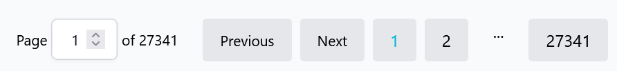{style="width: 601.70px; height: 69.33px; margin-left: 0.00px; margin-top: 0.00px; transform: rotate(0.00rad) translateZ(0px); -webkit-transform: rotate(0.00rad) translateZ(0px);"}]{style="overflow: hidden; display: inline-block; margin: 0.00px -0.00px; border: 1.33px solid #000000; transform: rotate(0.00rad) translateZ(0px); -webkit-transform: rotate(0.00rad) translateZ(0px); width: 601.70px; height: 69.33px;"}

[]{.c6}

[Sida 1 av 27341 - Föregående - Nästa]{.c12}

[]{.c6}

[Dölj sidofältet ]{.c8}

[{style="width: 264.00px; height: 85.00px; margin-left: 0.00px; margin-top: 0.00px; transform: rotate(0.00rad) translateZ(0px); -webkit-transform: rotate(0.00rad) translateZ(0px);"}]{style="overflow: hidden; display: inline-block; margin: 0.00px 0.00px; border: 1.33px solid #000000; transform: rotate(0.00rad) translateZ(0px); -webkit-transform: rotate(0.00rad) translateZ(0px); width: 264.00px; height: 85.00px;"}

[]{.c6}

[]{.c6}

[Search and browse buttons]{.c6}

[]{.c6}

[Tillbaka till träfflista]{.c8}

[]{.c6}

[{style="width: 198.00px; height: 70.00px; margin-left: 0.00px; margin-top: 0.00px; transform: rotate(0.00rad) translateZ(0px); -webkit-transform: rotate(0.00rad) translateZ(0px);"}]{style="overflow: hidden; display: inline-block; margin: 0.00px -0.00px; border: 1.33px solid #000000; transform: rotate(0.00rad) translateZ(0px); -webkit-transform: rotate(0.00rad) translateZ(0px); width: 198.00px; height: 70.00px;"}

[]{.c6}

[Tillbaka till bläddringen (?)]{.c0}

[]{.c6}

[{style="width: 198.00px; height: 61.00px; margin-left: 0.00px; margin-top: 0.00px; transform: rotate(0.00rad) translateZ(0px); -webkit-transform: rotate(0.00rad) translateZ(0px);"}]{style="overflow: hidden; display: inline-block; margin: -0.00px -0.00px; border: 1.33px solid #000000; transform: rotate(0.00rad) translateZ(0px); -webkit-transform: rotate(0.00rad) translateZ(0px); width: 198.00px; height: 61.00px;"}

[]{.c6}

[Föregående träff]{.c8}

[{style="width: 162.00px; height: 61.00px; margin-left: 0.00px; margin-top: 0.00px; transform: rotate(0.00rad) translateZ(0px); -webkit-transform: rotate(0.00rad) translateZ(0px);"}]{style="overflow: hidden; display: inline-block; margin: -0.00px -0.00px; border: 1.33px solid #000000; transform: rotate(0.00rad) translateZ(0px); -webkit-transform: rotate(0.00rad) translateZ(0px); width: 162.00px; height: 61.00px;"}

[]{.c6}

[Nästa träff]{.c8}

[]{.c6}

[{style="width: 126.00px; height: 58.00px; margin-left: 0.00px; margin-top: 0.00px; transform: rotate(0.00rad) translateZ(0px); -webkit-transform: rotate(0.00rad) translateZ(0px);"}]{style="overflow: hidden; display: inline-block; margin: -0.00px -0.00px; border: 1.33px solid #000000; transform: rotate(0.00rad) translateZ(0px); -webkit-transform: rotate(0.00rad) translateZ(0px); width: 126.00px; height: 58.00px;"}

[]{.c6}

[Föregående sida]{.c8}

[]{.c6}

[{style="width: 186.00px; height: 61.00px; margin-left: 0.00px; margin-top: 0.00px; transform: rotate(0.00rad) translateZ(0px); -webkit-transform: rotate(0.00rad) translateZ(0px);"}]{style="overflow: hidden; display: inline-block; margin: -0.00px -0.00px; border: 1.33px solid #000000; transform: rotate(0.00rad) translateZ(0px); -webkit-transform: rotate(0.00rad) translateZ(0px); width: 186.00px; height: 61.00px;"}

[]{.c6}

[Nästa sida]{.c8}

[]{.c8}

[{style="width: 141.00px; height: 61.00px; margin-left: 0.00px; margin-top: 0.00px; transform: rotate(0.00rad) translateZ(0px); -webkit-transform: rotate(0.00rad) translateZ(0px);"}]{style="overflow: hidden; display: inline-block; margin: -0.00px -0.00px; border: 1.33px solid #000000; transform: rotate(0.00rad) translateZ(0px); -webkit-transform: rotate(0.00rad) translateZ(0px); width: 141.00px; height: 61.00px;"}

[]{.c0}

[Visa annoteringar]{.c12 .c18}^[\[f\]](#cmnt6){#cmnt_ref6}^

[]{.c6}

[{style="width: 232.00px; height: 64.00px; margin-left: 0.00px; margin-top: 0.00px; transform: rotate(0.00rad) translateZ(0px); -webkit-transform: rotate(0.00rad) translateZ(0px);"}]{style="overflow: hidden; display: inline-block; margin: 0.00px -0.00px; border: 1.33px solid #000000; transform: rotate(0.00rad) translateZ(0px); -webkit-transform: rotate(0.00rad) translateZ(0px); width: 232.00px; height: 64.00px;"}

[]{.c6}

[Visa identifierade ]{.c12}[layoutelement]{.c12}[ ]{.c0}

[]{.c6}

[Dölj texten]{.c8}

[{style="width: 133.00px; height: 64.00px; margin-left: 0.00px; margin-top: 0.00px; transform: rotate(0.00rad) translateZ(0px); -webkit-transform: rotate(0.00rad) translateZ(0px);"}]{style="overflow: hidden; display: inline-block; margin: 0.00px -0.00px; border: 1.33px solid #000000; transform: rotate(0.00rad) translateZ(0px); -webkit-transform: rotate(0.00rad) translateZ(0px); width: 133.00px; height: 64.00px;"}

[]{.c6}

[Dölj bilden]{.c8}

[{style="width: 158.00px; height: 60.00px; margin-left: 0.00px; margin-top: 0.00px; transform: rotate(0.00rad) translateZ(0px); -webkit-transform: rotate(0.00rad) translateZ(0px);"}]{style="overflow: hidden; display: inline-block; margin: -0.00px -0.00px; border: 1.33px solid #000000; transform: rotate(0.00rad) translateZ(0px); -webkit-transform: rotate(0.00rad) translateZ(0px); width: 158.00px; height: 60.00px;"}

[]{.c0}

[Maximera bilden]{.c8}

[]{.c0}

[{style="width: 208.00px; height: 64.00px; margin-left: 0.00px; margin-top: 0.00px; transform: rotate(0.00rad) translateZ(0px); -webkit-transform: rotate(0.00rad) translateZ(0px);"}]{style="overflow: hidden; display: inline-block; margin: 0.00px -0.00px; border: 1.33px solid #000000; transform: rotate(0.00rad) translateZ(0px); -webkit-transform: rotate(0.00rad) translateZ(0px); width: 208.00px; height: 64.00px;"}

[]{.c0}

[Ladda ner texten]{.c8}

[]{.c6}

[{style="width: 194.00px; height: 62.00px; margin-left: 0.00px; margin-top: 0.00px; transform: rotate(0.00rad) translateZ(0px); -webkit-transform: rotate(0.00rad) translateZ(0px);"}]{style="overflow: hidden; display: inline-block; margin: 0.00px -0.00px; border: 1.33px solid #000000; transform: rotate(0.00rad) translateZ(0px); -webkit-transform: rotate(0.00rad) translateZ(0px); width: 194.00px; height: 62.00px;"}

[]{.c6}

[Ladda ner bilden]{.c8}

[]{.c6}

[{style="width: 211.00px; height: 63.00px; margin-left: 0.00px; margin-top: 0.00px; transform: rotate(0.00rad) translateZ(0px); -webkit-transform: rotate(0.00rad) translateZ(0px);"}]{style="overflow: hidden; display: inline-block; margin: 0.00px -0.00px; border: 1.33px solid #000000; transform: rotate(0.00rad) translateZ(0px); -webkit-transform: rotate(0.00rad) translateZ(0px); width: 211.00px; height: 63.00px;"}

[]{.c6}

[]{.c6}

[Metadata]{.c8}

[]{.c4}

[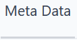{style="width: 112.00px; height: 58.00px; margin-left: 0.00px; margin-top: 0.00px; transform: rotate(0.00rad) translateZ(0px); -webkit-transform: rotate(0.00rad) translateZ(0px);"}]{style="overflow: hidden; display: inline-block; margin: -0.00px 0.00px; border: 1.33px solid #000000; transform: rotate(0.00rad) translateZ(0px); -webkit-transform: rotate(0.00rad) translateZ(0px); width: 112.00px; height: 49.49px;"}

[]{.c6}

[Visa metadata]{.c0}

[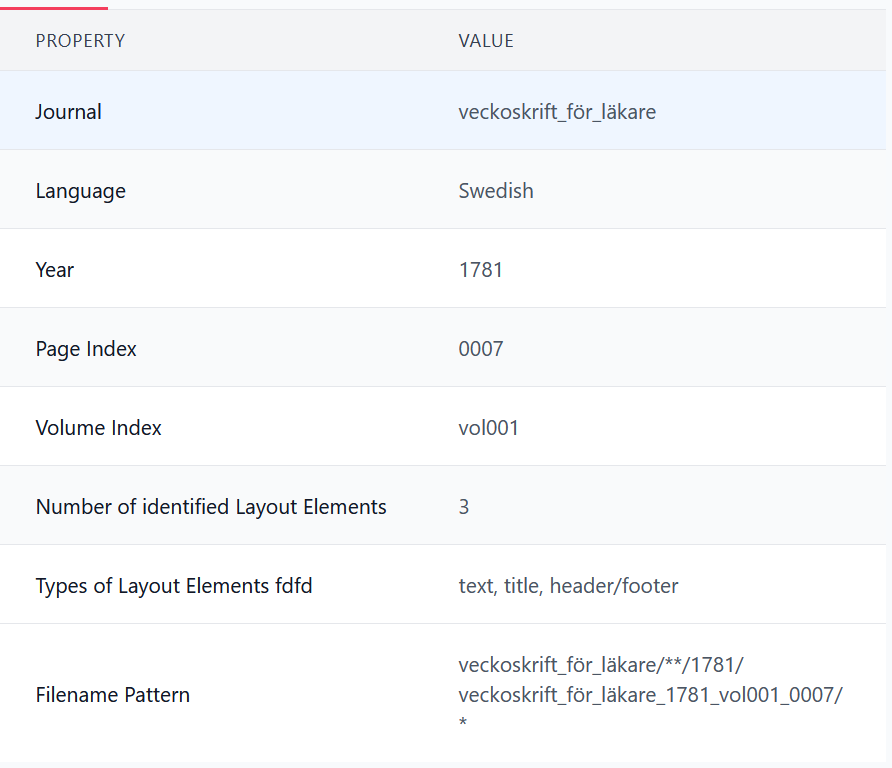{style="width: 601.70px; height: 518.67px; margin-left: 0.00px; margin-top: 0.00px; transform: rotate(0.00rad) translateZ(0px); -webkit-transform: rotate(0.00rad) translateZ(0px);"}]{style="overflow: hidden; display: inline-block; margin: 0.00px 0.00px; border: 0.00px solid #000000; transform: rotate(0.00rad) translateZ(0px); -webkit-transform: rotate(0.00rad) translateZ(0px); width: 601.70px; height: 518.67px;"}

[]{.c6}

[]{.c0}

[Tidskrift]{.c0}

[Språk]{.c0}

[År]{.c0}

[Sidindex]{.c0}

[Volymindex]{.c0}

[Antal identifierade layoutelement]{.c0}

[Typer av layoutelement]{.c0}

[Filnamnsmönster]{.c12}^[\[g\]](#cmnt7){#cmnt_ref7}^

[]{.c4}

[]{.c4}

[Pipeline]{.c12 .c18}^[\[h\]](#cmnt8){#cmnt_ref8}^

[]{.c4}

[{style="width: 91.00px; height: 54.00px; margin-left: 0.00px; margin-top: 0.00px; transform: rotate(0.00rad) translateZ(0px); -webkit-transform: rotate(0.00rad) translateZ(0px);"}]{style="overflow: hidden; display: inline-block; margin: -0.00px 0.00px; border: 1.33px solid #000000; transform: rotate(0.00rad) translateZ(0px); -webkit-transform: rotate(0.00rad) translateZ(0px); width: 91.00px; height: 54.00px;"}

[]{.c4}

[Text extraherat med Swemper pipeline. Läs mer om
digitaliseringsprocessen här. ]{.c12}

[]{.c4}

[Tesseract V1]{.c8}

[]{.c4}

[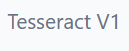{style="width: 129.00px; height: 51.00px; margin-left: 0.00px; margin-top: 0.00px; transform: rotate(0.00rad) translateZ(0px); -webkit-transform: rotate(0.00rad) translateZ(0px);"}]{style="overflow: hidden; display: inline-block; margin: -0.00px -0.00px; border: 1.33px solid #000000; transform: rotate(0.00rad) translateZ(0px); -webkit-transform: rotate(0.00rad) translateZ(0px); width: 129.00px; height: 51.00px;"}

[]{.c6}

[Text extraherat med Tesseract OCR. Läs mer om digitaliseringsprocessen
här. ]{.c0}

[]{.c0}

[]{.c0}

[Digitaliseringsprocessen]{.c8}

[ ]{.c8}

[The Swemper database offers multiple OCR editions with different
qualities and affordances:]{.c0}

[]{.c0}

- [Swemper OCR: text extracted with the Swemper digitization pipeline
  including the recognition of individual layout elements on the page.
  The text within each identified layout element has been recognized
  individually with the help of Tesseract OCR.]{.c0}
- [Tesseract OCR: text extracted with Tesseract OCR of the entire page
  without Swempers layout recognition]{.c0}
- [L]{.c12}[ibrary OCR: text extracted with ABBYY FineReader during the
  scanning by the digitization partners Uppsala University Library and
  the Swedish National Archives (Riksarkivets Mediakonverteringscentrum
  MKC, Fränsta).]{.c0}

[]{.c0}

[More information:]{.c0}

[]{.c0}

[Dalia Ortiz Pablo, Sushruth Badri, Gijs Aangenendt, Mo von Bychelberg,
Matts Lindström (2025) A machine learning pipeline for digitalising
historical printed materials - from data collection to a searchable
database, In: Gerlof Bouma, Dana Dannélls, Dimitrios Kokkinakis, Elena
Volodina (Eds.) ]{.c12}[Huminfra handbook: Empowering digital and
experimental humanities]{.c12 .c18}[, NEALT Proceedings Series 59,
University of Tartu Library, pp. 207-250.]{.c0}

[]{.c0}

[]{.c0}

[Swemper-databasen erbjuder flera OCR-utgåvor med olika kvaliteter och
möjligheter:]{.c0}

[ ]{.c0}

- [Swemper OCR: text extraherad med Swempers digitaliseringspipeline
  inklusive igenkänning av enskilda layoutelement på sidan. Texten inom
  varje identifierat layoutelement har tolkats individuellt med hjälp av
  Tesseract OCR.]{.c0}
- [Tesseract OCR: text extraherad med Tesseract OCR av hela sidan utan
  Swempers layoutigenkänning.]{.c0}
- [Biblioteks-OCR: text extraherad med ABBYY FineReader under
  inskanningen av digitaliseringspartnerna Uppsala universitetsbibliotek
  och Riksarkivets Mediakonverteringscentrum MKC i Fränsta.]{.c0}

[]{.c8}

[Mer information:]{.c0}

[]{.c0}

[Dalia Ortiz Pablo, Sushruth Badri, Gijs Aangenendt, Mo von Bychelberg,
Matts Lindström (2025) A machine learning pipeline for digitalising
historical printed materials - from data collection to a searchable
database, In: Gerlof Bouma, Dana Dannélls, Dimitrios Kokkinakis, Elena
Volodina (Eds.) ]{.c12}[Huminfra handbook: Empowering digital and
experimental humanities]{.c12 .c18}[, NEALT Proceedings Series 59,
University of Tartu Library, pp. 207-250.]{.c0}

[]{.c0}

[]{.c6}

[]{.c6}

[]{.c6}

[]{.c6}

[]{.c6}

[]{.c6}

[]{.c6}

[]{.c6}

[]{.c6}

[]{.c6}

[]{.c6}

[]{.c6}

[]{.c6}

[]{.c6}

[]{.c6}

[]{.c6}

[]{.c6}

[]{.c6}

[]{.c6}

[]{.c6}

[]{.c6}

[]{.c6}

[]{.c6}

[]{.c6}

[]{.c6}

[]{.c6}

[]{.c6}

[]{.c6}

[]{.c6}

[]{.c6}

[]{.c6}

[Browse controls]{.c6}

[]{.c6}

[Välj en tidskrift]{.c8}

[]{.c0}

[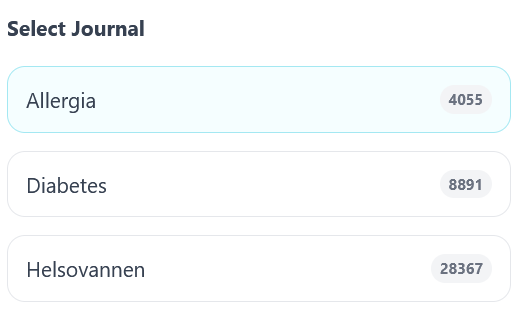{style="width: 230.50px; height: 137.68px; margin-left: 0.00px; margin-top: 0.00px; transform: rotate(0.00rad) translateZ(0px); -webkit-transform: rotate(0.00rad) translateZ(0px);"}]{style="overflow: hidden; display: inline-block; margin: -0.00px -0.00px; border: 1.33px solid #000000; transform: rotate(0.00rad) translateZ(0px); -webkit-transform: rotate(0.00rad) translateZ(0px); width: 230.50px; height: 137.68px;"}

[]{.c0}

[Filtrera på sidor med bilder eller annonser]{.c8}

[]{.c0}

[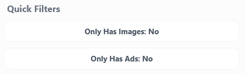{style="width: 341.50px; height: 103.51px; margin-left: 0.00px; margin-top: 0.00px; transform: rotate(0.00rad) translateZ(0px); -webkit-transform: rotate(0.00rad) translateZ(0px);"}]{style="overflow: hidden; display: inline-block; margin: 0.00px 0.00px; border: 1.33px solid #000000; transform: rotate(0.00rad) translateZ(0px); -webkit-transform: rotate(0.00rad) translateZ(0px); width: 341.50px; height: 103.51px;"}

[]{.c0}

[Visa endast sidor där en eller flera bilder och/eller annonser har
identifierats. Observera att vissa objekt kan ha missats eller
identifierats felaktigt.]{.c20}

[]{.c20}

[Tillgängliga år]{.c18 .c30}

[]{.c0}

[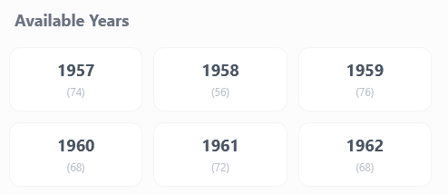{style="width: 370.51px; height: 160.50px; margin-left: 0.00px; margin-top: 0.00px; transform: rotate(0.00rad) translateZ(0px); -webkit-transform: rotate(0.00rad) translateZ(0px);"}]{style="overflow: hidden; display: inline-block; margin: -0.00px 0.00px; border: 1.33px solid #000000; transform: rotate(0.00rad) translateZ(0px); -webkit-transform: rotate(0.00rad) translateZ(0px); width: 370.51px; height: 160.50px;"}

[]{.c0}

[Välj ett år att bläddra igenom]{.c0}

[]{.c0}

[Sidnavigering]{.c8}

[]{.c8}

[{style="width: 601.70px; height: 69.33px; margin-left: 0.00px; margin-top: 0.00px; transform: rotate(0.00rad) translateZ(0px); -webkit-transform: rotate(0.00rad) translateZ(0px);"}]{style="overflow: hidden; display: inline-block; margin: 0.00px -0.00px; border: 1.33px solid #000000; transform: rotate(0.00rad) translateZ(0px); -webkit-transform: rotate(0.00rad) translateZ(0px); width: 601.70px; height: 69.33px;"}

[]{.c6}

[Sida 1 av 27341 - Föregående - Nästa]{.c12}

[]{.c0}

[Sortera]{.c12 .c18}^[\[i\]](#cmnt9){#cmnt_ref9}^

[]{.c0}

[{style="width: 40.00px; height: 51.00px; margin-left: 0.00px; margin-top: 0.00px; transform: rotate(0.00rad) translateZ(0px); -webkit-transform: rotate(0.00rad) translateZ(0px);"}]{style="overflow: hidden; display: inline-block; margin: -0.00px -0.00px; border: 1.33px solid #000000; transform: rotate(0.00rad) translateZ(0px); -webkit-transform: rotate(0.00rad) translateZ(0px); width: 40.00px; height: 51.00px;"}

[]{.c0}

[Sortera på]{.c0}

[]{.c0}

- [År - Äldst först]{.c0}
- [År - Nyast först]{.c0}

[]{.c0}

[Graf ]{.c8}

[]{.c0}

[{style="width: 310.00px; height: 85.00px; margin-left: 0.00px; margin-top: 0.00px; transform: rotate(0.00rad) translateZ(0px); -webkit-transform: rotate(0.00rad) translateZ(0px);"}]{style="overflow: hidden; display: inline-block; margin: 0.00px 0.00px; border: 1.33px solid #000000; transform: rotate(0.00rad) translateZ(0px); -webkit-transform: rotate(0.00rad) translateZ(0px); width: 310.00px; height: 85.00px;"}

[]{.c0}

[Visa graf]{.c0}

[]{.c0}

[{style="width: 310.51px; height: 81.56px; margin-left: 0.00px; margin-top: 0.00px; transform: rotate(0.00rad) translateZ(0px); -webkit-transform: rotate(0.00rad) translateZ(0px);"}]{style="overflow: hidden; display: inline-block; margin: 0.00px 0.00px; border: 1.33px solid #000000; transform: rotate(0.00rad) translateZ(0px); -webkit-transform: rotate(0.00rad) translateZ(0px); width: 310.51px; height: 81.56px;"}

[]{.c0}

[Dölj graf]{.c0}

[]{.c6}

[]{.c6}

[]{.c6}

[]{.c6}

[]{.c6}

[]{.c6}

## []{.c19} {#h.bhb99786sb3q .c27 .c29}

## [Examples of tooltips/information about search]{.c19} {#h.oy0vytthcb0g .c27}

[]{.c0}

[]{.c0}

[]{.c6}

[KB dagstidningar]{.c6}

[[https://feedback.blogg.kb.se/forums/topic/lathundar/](https://www.google.com/url?q=https://feedback.blogg.kb.se/forums/topic/lathundar/&sa=D&source=editors&ust=1787832283629314&usg=AOvVaw3RfnXygvRLTKnCjelDwbK-){.c15}]{.c25
.c12}[ ]{.c0}

[]{.c0}

[Detta är grundläggande information om tjänsten Svenska tidningar. Har
du frågor och synpunkter eller vill rapportera en bugg? Skriv inga
kommentarer i den här tråden! Vänligen använd istället trådarna under
"Forum"]{.c12
.c18}[[ ](https://www.google.com/url?q=https://feedback.blogg.kb.se/forums/forum/buggar/&sa=D&source=editors&ust=1787832283630042&usg=AOvVaw0AeRNLH2euCmIaqRV0yZbl){.c15}]{.c12
.c18}[[Buggar](https://www.google.com/url?q=https://feedback.blogg.kb.se/forums/forum/buggar/&sa=D&source=editors&ust=1787832283630214&usg=AOvVaw2lPy4r6-aCPC6ZIGVws4MW){.c15}]{.c25
.c12 .c18}[,]{.c12
.c18}[[ ](https://www.google.com/url?q=https://feedback.blogg.kb.se/forums/forum/synpunkter/&sa=D&source=editors&ust=1787832283630385&usg=AOvVaw3Tt7dXU4GUBMWd2DOcCiP6){.c15}]{.c12
.c18}[[Frågor och
synpunkter](https://www.google.com/url?q=https://feedback.blogg.kb.se/forums/forum/synpunkter/&sa=D&source=editors&ust=1787832283630574&usg=AOvVaw09XyU55zU5thqJN8nBPNJQ){.c15}]{.c25
.c12 .c18}[,]{.c12
.c18}[[ ](https://www.google.com/url?q=https://feedback.blogg.kb.se/forums/forum/faq-for-anslutna-organisationer-avtal-och-administration/&sa=D&source=editors&ust=1787832283630758&usg=AOvVaw0XcLWZ5N6_CALgevi1Q3Y5){.c15}]{.c12
.c18}[[FAQ för anslutna organisationer -- avtal och
administration](https://www.google.com/url?q=https://feedback.blogg.kb.se/forums/forum/faq-for-anslutna-organisationer-avtal-och-administration/&sa=D&source=editors&ust=1787832283631023&usg=AOvVaw1MJ1hD8_JjcP6E_xyU7oHg){.c15}]{.c25
.c12 .c18}[,]{.c12
.c18}[[ ](https://www.google.com/url?q=https://feedback.blogg.kb.se/forums/forum/faq-for-anslutna-organisationer-teknik-och-anslutning/&sa=D&source=editors&ust=1787832283631220&usg=AOvVaw3n1xcYIa4eHtfNebT0YIDW){.c15}]{.c12
.c18}[[FAQ för anslutna organisationer -- teknik och
anslutning](https://www.google.com/url?q=https://feedback.blogg.kb.se/forums/forum/faq-for-anslutna-organisationer-teknik-och-anslutning/&sa=D&source=editors&ust=1787832283631466&usg=AOvVaw0Q7z5jjYwb5RRUcostgHTb){.c15}]{.c25
.c12 .c18}

[Allmänna råd]{.c6}

[Sökresultatet genererar träffar utifrån texten på hela tidningssidan
och inte på enskilda artiklar.\
Texttolkningen av den digitaliserade texten är bra men inte perfekt.
Därför är ]{.c12}[Oskarp sökning]{.c17 .c12}[ och ]{.c12}[Sökning på
närliggande termer]{.c17 .c12}[ viktiga verktyg för att få ett gott
sökresultat.( Se nedan.)]{.c0}

[Omfattande sökningar\
]{.c17 .c12}[ Tjänsten kan returnera maximalt 10 000 träffar per
söksträng, även om sökresultatet uppger fler träffar.]{.c0}

[Får du fler än 10 000 träffar för en sökning kan du alltså endast se de
första 10 000.]{.c0}

[Om sökningen returnerar fler än 10 000 träffar: dela upp sökningen i
flera tidsspann, för att på så sätt underskrida 10 000 träffar för varje
enskild tidsperiod.]{.c0}

[Sökoperatorer\
]{.c17 .c12}[ Använd stora bokstäver\
AND -alla sökord ska finnas\
OR -ett eller flera sökord ska finnas\
NOT -- utesluter efterföljande sökord]{.c0}

[Frassökning och sökning på exakt stavning\
]{.c17 .c12}[ Sätt fras inom citattecken\
Exempel : "storgädda på kroken"]{.c0}

[Systemet tillämpar ]{.c12}[stemming]{.c12 .c18}[, som kan jämföras med
automattrunkering. Sätt sökordet eller sökfrasen inom citattecken för
att få träff på exakt stavning utan ändelser.]{.c0}

[Exempel: "svensk"]{.c0}

[Versaler och gemener\
]{.c17 .c12}[ Betraktas som samma tecken (utom sökoperatorerna AND OR
NOT)]{.c0}

[Trunkera\
]{.c17 .c12}[ Använd asterisk \* för att söka bland ord med varierande
stavning och ändelser.]{.c0}

[Exempel: ]{.c12}[svensk\*]{.c12 .c18}[ kan ge sökresultat som svensk,
svenskar, svenskarna, svenskarnas etc.]{.c0}

[Även utan trunkering så inkluderas vissa böjningar av ett sökord, då
det görs automatiskt av sökmotorn (så kallad "stemming"). För att
garanterat få med samtliga böjningar eller sammansättningar av sökordet
(dock inte alltid sökordet själv) är trunkering ett bra
alternativ.]{.c0}

[Mer fördjupande information om sökmotorns principer för trunkering
finns att läsa här:\
]{.c12}[[ ](https://www.google.com/url?q=https://snowballstem.org/algorithms/swedish/stemmer.html&sa=D&source=editors&ust=1787832283636580&usg=AOvVaw3oyJq3zn5LDcoeXx4HX7e3){.c15}]{.c12}[[Swedish
stemming algorithm\
](https://www.google.com/url?q=https://snowballstem.org/algorithms/swedish/stemmer.html&sa=D&source=editors&ust=1787832283636995&usg=AOvVaw0UpiDZHeEFYRsx3xVSLQpu){.c15}]{.c25
.c12}[[ ](https://www.google.com/url?q=https://snowballstem.org/demo.html%23Swedish&sa=D&source=editors&ust=1787832283637227&usg=AOvVaw1tqRoXiOneIssUzH_YwxH9){.c15}]{.c12}[[Demo
--
Snowball](https://www.google.com/url?q=https://snowballstem.org/demo.html%23Swedish&sa=D&source=editors&ust=1787832283637509&usg=AOvVaw1uxtpv1lUZxtCOCIX6hwbc){.c15}]{.c25
.c12}

[Trunkering fungerar inte inom en frassökning ("...").]{.c0}

[Det går inte att starta ett sökord med trunkeringstecken]{.c0}

[Maskera\
]{.c12 .c17}[ Använd frågetecken (?) för att hitta stavningsvarianter.
Varje frågetecken motsvarar ett tecken.]{.c0}

[Exempel: ]{.c12}[mi?rofilm]{.c12 .c18}[ kommer att matcha både
mikrofilm och microfilm]{.c0}

[Maskering fungerar inte i frassökning.]{.c0}

[Det går inte att starta ett sökord med maskeringstecken]{.c0}

[Oskarp sökning\
]{.c17 .c12}[ '\~' tildetecken i slutet av ett sökord ger sökresultat
som har liknande stavning till den givna söktermen.]{.c0}

[Exempel: quinna\~ kan ge sökresultat som quinna, kvinna, quinoa
etc.]{.c0}

[Dostovjevski\~ ger träff på olika stavningar.]{.c0}

[Oskarp sökning fungerar inte i frassökning.]{.c0}

[Sökning på närliggande termer\
]{.c17 .c12}[ Då textmassan inte har någon artikelindelning och sökning
görs på hela sidor kan man behöva kräva att de ord man söker på står
inom ett visst avstånd från varandra. Detta görs genom att skriva
söktermer inom citationstecken följt av '\~' och de antal ord som
maximalt får skilja söktermerna åt.]{.c0}

[Exempel:]{.c0}

["sickan hasse"\~25]{.c0}

[Ger träff på alla sidor där sickan och hasse står 0-25 ord från
varandra.]{.c0}

[Stoppord\
]{.c17 .c12}[ Stoppord är betydelsefattiga ord som förekommer i nästan
alla texter.]{.c0}

[Exempel: i, och, eller, men, en, ett. att, hade]{.c0}

[Stoppord ger inga träffar, annat än om de ingår i frassökning.]{.c0}

[Exempel:\
'hade' ger inga träffar]{.c0}

['"jag hade tur"' ger träffar på den specifika frasen.]{.c0}

[Lista på gällande stoppord
finns]{.c12}[[ ](https://www.google.com/url?q=https://feedback.blogg.kb.se/files/2024/02/Stoppord.pdf&sa=D&source=editors&ust=1787832283642325&usg=AOvVaw2lC-ts_vfNbGEX3wE68Fc-){.c15}]{.c12}[[här](https://www.google.com/url?q=https://feedback.blogg.kb.se/files/2024/02/Stoppord.pdf&sa=D&source=editors&ust=1787832283642636&usg=AOvVaw0sWJQVqzCxaOHfxU3H8Q2u){.c15}]{.c25
.c12}

[Parenteser och söklogik\
]{.c17 .c12}[ Gruppering av sökord kan användas för att definiera hur
operatorerna uppträder (och därmed bilda underfrågor). Gruppering uppnås
via parentes ( )\
Exempel: (sickan OR carlsson) AND stjärna AND (svartsjuk NOT munter)\
Söker efter alla poster som innehåller antingen sickan eller carlsson,
innehåller termen stjärna och innehåller ordet svartsjuk men inte ordet
munter.]{.c0}

[Sök på allt material\
]{.c17 .c12}[ Att klicka på "Sök" i tom sökruta genererar en sökträff på
alla tidningssidor i databasen]{.c0}

[]{.c0}

[]{.c0}

[Impresso ]{.c6}

[]{.c6}

[FAQ ]{.c17
.c12}[[https://impresso-project.ch/app/faq#how-to-make-and-and-or-queries](https://www.google.com/url?q=https://impresso-project.ch/app/faq%23how-to-make-and-and-or-queries&sa=D&source=editors&ust=1787832283644062&usg=AOvVaw32ylziIWGaIAEfib4K5i88){.c15}]{.c25
.c12}[ ]{.c0}

[]{.c0}

[]{.c0}

[Riksdagsdebatter]{.c6}

[]{.c0}

[Ordtrender --- Sök på ett eller flera ord för att se hur de har använts
över tid.]{.c6}

[För att söka på flera ord, separera dem med kommatecken, till exempel:
]{.c12}[frihet, jämlikhet]{.c22 .c12}[. Sök med ]{.c12}[\*]{.c22
.c12}[ för att få fler ordvarianter, till exempel:
]{.c12}[frihet\*]{.c22 .c12}[. Under ]{.c12}[\"Filtrera på
metadata\"]{.c17 .c12}[ kan du avgränsa anförandena till bland annat
vissa partier, talare eller år.]{.c0}

[]{.c0}

[Key Words in Context --- Sök på ett ord eller en fras och se hur de har
använts i olika sammanhang. ]{.c6}

[Med verktyget ]{.c12}[Key Words in Context]{.c17 .c12}[ kan du söka på
ord och fraser, till exempel ]{.c12}[jämlikhet]{.c22 .c12}[ eller
]{.c12}[jämlikhet för]{.c12 .c22}[, och se kontexten till vänster och
höger om sökningen. För att få fler träffar kan ]{.c12}[\*]{.c22
.c12}[ användas, till exempel ]{.c12}[frihet\*]{.c22 .c12}[. Under
]{.c12}[\"Filtrera på metadata\"]{.c17 .c12}[ kan du avgränsa
anförandena till bland annat vissa partier, talare eller år. ]{.c0}

[]{.c0}

[Anföranden --- Sök på och filtrera fram riksdagsanföranden.]{.c6}

[Sök på hela anföranden. Under ]{.c12}[\"Filtrera på metadata\"]{.c17
.c12}[ kan du avgränsa anförandena till bland annat vissa partier,
talare eller år.]{.c0}

[]{.c0}

[N-grams --- Sök på ett ord eller en fras och se hur de har använts i
olika sammanhang]{.c17 .c12}[.]{.c0}

[Med verktyget ]{.c12}[N-gram]{.c17 .c12}[ kan du söka på ord och
fraser, till exempel ]{.c12}[jämlikhet]{.c22 .c12}[ eller
]{.c12}[jämlikhet för]{.c22 .c12}[, och få fram en lista med mest
förekommande N-grams (beroende på dess storlek) före och/eller efter
sökordet eller sökfrasen. Här måste du söka på exakta ord fraser
(]{.c12}[\*]{.c22 .c12}[ kan inte användas). Under ]{.c12}["Filtrera på
metadata"]{.c17 .c12}[ kan du avgränsa anförandena till bland annat
vissa partier, talare eller år.]{.c0}

[]{.c0}

[Svensk mediadatabas]{.c6}

[[https://smdb.kb.se/smdb/soktips](https://www.google.com/url?q=https://smdb.kb.se/smdb/soktips&sa=D&source=editors&ust=1787832283647702&usg=AOvVaw2873hedU4RHhZpSltnjZyX){.c15}]{.c25
.c12}[ ]{.c0}

[]{.c0}

[De audiovisuella samlingarna är beskrivna på olika nivåer. Ibland
innehåller posterna detaljerade beskrivningar, ibland är de mer
kortfattade och saknar uppgifter om exempelvis innehåll och
medverkande.]{.c6}

[I SMDB kan du göra både enkla och utökade sökningar. Med tipsen nedan
kan du göra sökningarna mer kraftfulla.]{.c0}

### [Enkel sökning]{.c10} {#h.kw4md0w3qexo .c9}

[Högst upp på sidan hittar du sökrutan för enkel sökning. I denna ruta
kan du söka med fri text, vilket innebär att du söker i databasens
samtliga fält (till exempel Titel, Datum, Person).]{.c0}

[Du kan söka på ett eller flera ord i sökrutan.]{.c0}

[Exempel:\
]{.c12}[abba movie]{.c6}

[Du får träffar på poster som innehåller både ordet "abba" och ordet
"movie".]{.c0}

### [Sök exakta fraser]{.c10} {#h.6i861ddg3g6i .c9}

[Genom att använda citationstecken kan du söka på en exakt fras.]{.c0}

[Exempel:\
]{.c12}["saturday night fever"]{.c6}

[Du får träffar på poster som innehåller den exakta frasen "Saturday
night fever".]{.c0}

### [Sök ord som står nära varandra]{.c10} {#h.rdn0k7p173a6 .c9}

[Sök efter ord som står nära varandra i en titel eller annan text genom
att använda parentes. Ordens inbördes ordning spelar ingen roll.]{.c0}

[Exempel:\
]{.c12}[(the who)]{.c6}

[Du får träffar på poster där ordet "the" och ordet "who" befinner sig
nära varandra, till exempel "Who, the" och "The man who wasn't
there".]{.c0}

[Exempel:\
]{.c12}[(monica zetterlund)]{.c6}

[Du får träffar på poster där namnet Monica Zetterlund står både i rak
och omvänd ordföljd.]{.c0}

### [Kombinera ord]{.c10} {#h.exfztrn21xcc .c9}

[Du kan kombinera ord genom att skriva OCH, ELLER eller INTE mellan
orden när du söker. Observera att du måste skriva OCH, ELLER eller INTE
med stora bokstäver.]{.c0}

[Exempel:\
]{.c12}[gudfadern OCH pacino]{.c6}

[Du får träffar på poster där både "Gudfadern" och "Pacino"
förekommer.]{.c0}

[Exempel]{.c12}[:\
gudfadern ELLER pacino\
]{.c17 .c12}[ Du får träffar på poster där antingen "Gudfadern" eller
"Pacino" förekommer.]{.c0}

[Exempel]{.c12}[:\
gudfadern INTE Pacino]{.c6}

[Du får träffar på poster där "Gudfadern" förekommer, men inte
"Pacino".]{.c0}

### [Sök ord med olika ändelser]{.c10} {#h.7o61keusifk3 .c9}

[Använd asterisk (\*) för att hitta ord med olika ändelser.]{.c0}

[Exempel:\
]{.c12}[jazz\*]{.c6}

[Du får träffar på poster med ord som börjar på jazz, till exempel
"jazz", "jazzmusiker", "jazzartist".]{.c0}

### [Utökad sökning]{.c10} {#h.l2f6bfs6zi76 .c9}

[Börja gärna med att söka i fritextfältet för att få en så stor
träffmängd som möjligt. Därefter kan du avgränsa din sökning till olika
fält.]{.c0}

[Fritext -- söker i alla fält i en post\
Titel -- söker i titelfält, till exempel huvudtitlar, låttitlar och
titlar på radio- och tv-program\
Person -- söker på namn på personer som hör ihop med en post.
Personfältet används främst för medietyperna film och musik, men är inte
lika vanligt för tv och radio. För att inte missa relevanta träffar, sök
först på namnet i fritextfältet.\
Grupp -- söker på namn på grupper som hör ihop med en post.\
Medietyp -- söker på material av en viss medietyp\
År/Datum -- söker på material som givits ut ett visst år eller inom ett
tidsintervall.\
Kanal -- söker på tv- och radioprogram som sänts i en viss kanal]{.c0}

### [Sök digitalt material]{.c10} {#h.trdy0vq03scy .c9}

[Om du endast vill söka på material som redan är digitalt, gå in i
"Utökad sökning" och bocka för sökrutan "Sök poster som innehåller
digitalt material". I träfflistan som dyker upp står texten "Digitalt
material finns". Det innebär att posterna innehåller digitalt
material.]{.c0}

[Observera att du endast kan se exakt vilka inslag/program i en post som
är digitala genom att vara inloggad eller vara på plats vid de
audiovisuella datorerna på KB. Har du inget eget konto, kontakta
personalen för att bekräfta om det du söker är uppspelningsbart.]{.c6}

### [Sök efter journalfilmer]{.c10} {#h.12222xfki1x6 .c9}

[SMDB innehåller många journalfilmer som visats på svenska biografer
från 1910-talet till 1960-talet. För att söka efter dessa, sök i
fritextrutan på "journal digital" i kombination med valfria
sökord.]{.c0}

[Exempel:]{.c0}

["journal digital" göteborg]{.c6}

[Du får träffar med poster som innehåller filmer med anknytning till
Göteborg.]{.c0}

### [Sökspråk i SMDB]{.c10} {#h.l28o9elvjmkk .c9}

[I stället för att använda den utökade sökningen går det att skriva
begränsningarna direkt i fritextfältet:]{.c0}

[Sökning på titel: ]{.c12}[titel: "Pippi Långstrump"\
]{.c17 .c12}[ Sökning på medietyp:]{.c12}[ typ: TV\
]{.c17 .c12}[ Sökning på år/datum: ]{.c12}[datum:1979-1982
date:19790101-19821231\
]{.c17 .c12}[ Sökning på person: ]{.c12}[person: "Astrid Lindgren"\
]{.c17 .c12}[ Sökning på grupp: ]{.c12}[grupp: "bob hund"]{.c6}

[]{.c0}

[]{.c6}

[PubMed]{.c6}

[[https://pubmed.ncbi.nlm.nih.gov/help/](https://www.google.com/url?q=https://pubmed.ncbi.nlm.nih.gov/help/&sa=D&source=editors&ust=1787832283655842&usg=AOvVaw28C4cQ5ApXDZrV78fh_ybR){.c15}]{.c12
.c25}[ ]{.c0}

[]{.c0}

[Libris]{.c6}

[[https://libris.kb.se/help/search](https://www.google.com/url?q=https://libris.kb.se/help/search&sa=D&source=editors&ust=1787832283656273&usg=AOvVaw3TgYyQHMMXlMMQHT4z9kBK){.c15}]{.c25
.c12}[ ]{.c0}

[]{.c0}

[Archive.org]{.c6}

[[https://help.archive.org/help/search-a-basic-guide/](https://www.google.com/url?q=https://help.archive.org/help/search-a-basic-guide/&sa=D&source=editors&ust=1787832283656691&usg=AOvVaw0_9wni8xWt6PaLn2Y3tB1k){.c15}]{.c25
.c12}[ ]{.c0}

[]{.c0}

[]{.c0}

::: c21
[\[a\]](#cmnt_ref1){#cmnt1}[Is it possible to combine boolean operators
with parentheses?]{.c20}
:::

::: c21
[\[b\]](#cmnt_ref2){#cmnt2}[I haven\'t tried!]{.c20}
:::

::: c21
[\[c\]](#cmnt_ref3){#cmnt3}[Will this filter be included in the final
version of search?]{.c20}
:::

::: c21
[\[d\]](#cmnt_ref4){#cmnt4}[i think so yes]{.c20}
:::

::: c21
[\[e\]](#cmnt_ref5){#cmnt5}[Is the list view to be included in future
versions?]{.c20}
:::

::: c21
[\[f\]](#cmnt_ref6){#cmnt6}[Probably use another word]{.c20}
:::

::: c21
[\[g\]](#cmnt_ref7){#cmnt7}[Will this be included in the public
version?]{.c20}
:::

::: c21
[\[h\]](#cmnt_ref8){#cmnt8}[More descriptive label necessary,
suggestion: Swemper OCR?]{.c20}
:::

::: c21
[\[i\]](#cmnt_ref9){#cmnt9}[Do users want to browse from newest
first?]{.c20}
:::
